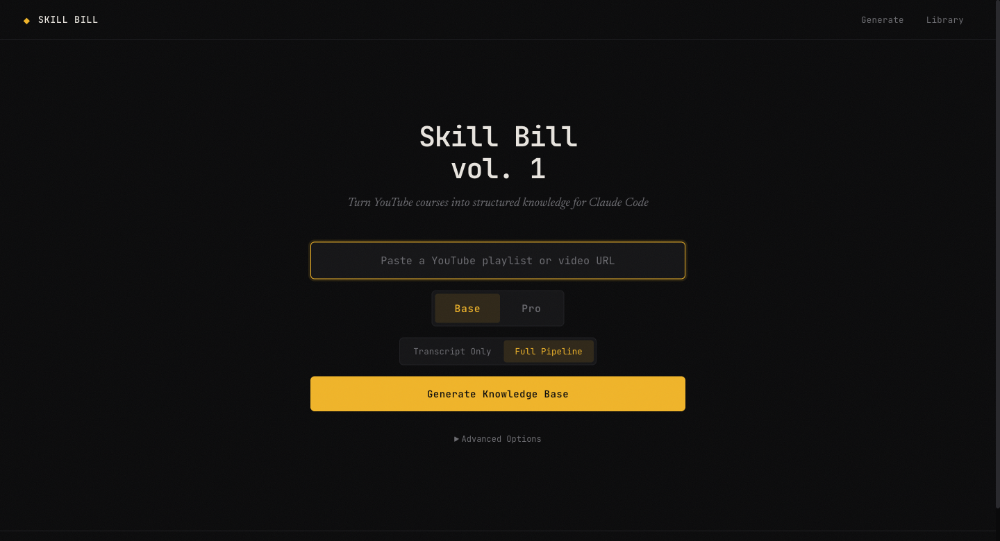
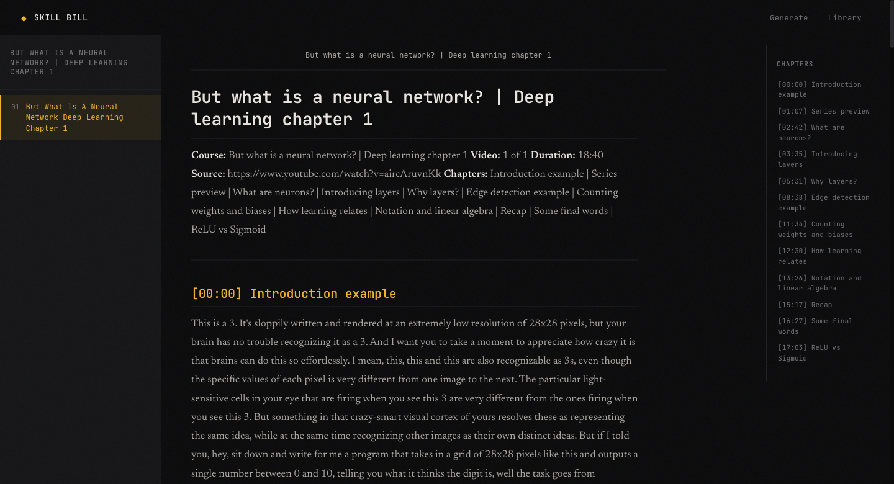
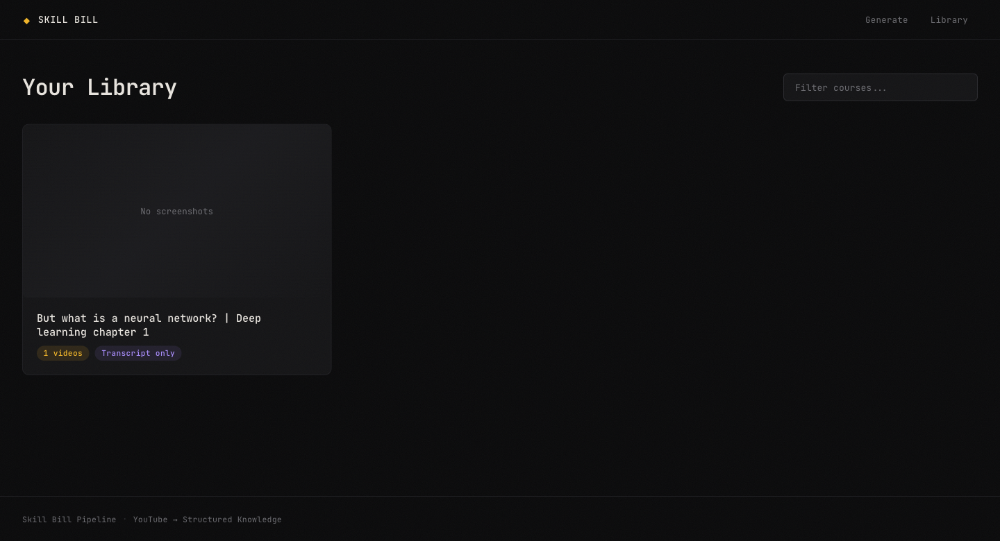

# Skill Bill vol. 1

**Turn any YouTube course into a Claude Code skill.**

Paste a playlist URL. Get back a structured, chapter-indexed knowledge base with inline screenshots — packaged as a `SKILL.md` bundle you can drop straight into `~/.claude/skills/`.

<p align="center">
  
</p>

---

## Why

Good technical content lives in video, which is the worst possible format for an agent to consume. A 12-part course is three hours you have to sit through, and none of it is greppable.

Skill Bill converts that course into what an agent actually wants: markdown, chunked per lesson, timestamped by chapter, with the screenshots that carry the information the narration skips. Then it writes the `SKILL.md` frontmatter so Claude Code knows when to reach for it.

## What you get

```
neural-networks-deep-learning/
  SKILL.md                    # frontmatter + routing rules for Claude Code
  index.md                    # course overview, every lesson linked
  01-what-is-a-neural-network.md
  02-gradient-descent.md
  ...
  assets/
    01/
      02-14.png               # screenshots, captured where they matter
      05-30.png
  topics.json                 # keyword → lesson index (Pro mode)
```

Each lesson file carries a metadata header, `## [MM:SS] Chapter Title` sections, transcript text, and screenshots interleaved inline at the timestamp they were taken:

```markdown
## [08:38] Edge detection example

But if I told you, hey, sit down and write for me a program that takes in a
grid of 28x28 pixels like this and outputs a single number between 0 and 10...


```

The generated `SKILL.md` tells Claude how to navigate it — read the index first, load one lesson at a time, jump by chapter heading rather than reading whole transcripts:

```yaml
---
name: neural-networks-deep-learning
description: >
  Reference knowledge base from Neural Networks (4 videos) covering
  backpropagation, gradient descent... Use when user asks about these
  topics, wants to reference video content, or asks "what does the
  course say about [topic]?"
metadata:
  author: Skill Bill
  version: "1.0"
  source: youtube-playlist
---
```

## Quickstart

**Prerequisites:** Python 3.10+, [ffmpeg](https://ffmpeg.org/download.html) (`brew install ffmpeg`).

```bash
git clone https://github.com/asrith926/skill-bill-vol-1.git
cd skill-bill-vol-1
python -m venv .venv && source .venv/bin/activate
pip install -r requirements.txt
```

Transcript-only — fast, no video download, no API key:

```bash
python run.py playlist "https://www.youtube.com/playlist?list=YOUR_PLAYLIST_ID" --transcript-only
```

Full pipeline, with screenshots:

```bash
python run.py playlist "https://www.youtube.com/playlist?list=..."
```

A single video works too:

```bash
python run.py video "https://www.youtube.com/watch?v=aircAruvnKk"
```

Output lands in `data/knowledge_base/<course-slug>/`.

**Install the result as a skill:**

```bash
cp -r data/knowledge_base/<course-slug> ~/.claude/skills/
```

Or use the web UI's **Download as Skill** button, which hands you a ready-to-unzip bundle with `SKILL.md` already written.

## Web UI

```bash
python run.py serve     # http://127.0.0.1:8000
```

Paste a URL, watch the stages stream over a WebSocket, then browse what came out — a reader view with a chapter rail, a lightbox for screenshots, and one-click skill packaging.

<p align="center">
  
  <br>
  <em>Reader view — chapter rail on the right, lesson nav on the left</em>
</p>

<p align="center">
  
  <br>
  <em>Library — every course you've generated</em>
</p>

## Base vs Pro

|                | Base                              | Pro (`--refine`)                                |
| -------------- | --------------------------------- | ----------------------------------------------- |
| Transcripts    | ✅                                 | ✅                                               |
| Screenshots    | ✅ local heuristics                | ✅ filtered + vision-captioned                   |
| Lesson steps   | raw transcript                    | extracted into clean numbered steps              |
| Titles         | as-published                      | cleaned                                          |
| Topic index    | —                                 | `topics.json` keyword lookup                     |
| API key        | not required                      | `ANTHROPIC_API_KEY`                              |
| Rough cost     | free                              | ~$0.15–0.20 per video                            |

```bash
ANTHROPIC_API_KEY=sk-... python run.py playlist "URL" --refine
```

Base mode optionally uses Haiku for segment classification (~$0.02/video). Turn it off entirely with `--no-haiku` and it falls back to local heuristics.

*Cost figures are rough estimates from development runs, not measured guarantees — they scale with video length.*

## How it works

| Stage | Module          | What happens                                                                     |
| ----- | --------------- | -------------------------------------------------------------------------------- |
| 1     | `downloader.py` | Flat playlist discovery via yt-dlp — one request, no per-video calls              |
| 2     | `transcript.py` | Transcript extraction, 3-tier fallback: cache → yt-dlp → Playwright               |
| 3     | `downloader.py` | Video download, cached by course slug                                            |
| 4     | `analyzer.py`   | Screenshot planning — segments classified, talking-head stretches skipped entirely |
| 5     | `capturer.py`   | ffmpeg frame extraction + perceptual-hash dedup, thresholds per segment type      |
| 6     | `generator.py`  | Jinja2 markdown assembly, screenshots interleaved by timestamp                    |
| 7     | `refiner.py`    | *(Pro)* Haiku vision captioning, lesson extraction, topic index                   |

The screenshot logic is the part worth knowing about. Sampling a video on a fixed interval produces hundreds of near-identical frames of someone's face. Instead, each segment is classified by type, and dedup thresholds vary accordingly — `code-demo` is strict (a two-character diff matters), `talking-head` is loose (the face doesn't change), and talking-head segments are usually planned to zero screenshots up front.

Everything caches. Re-running a course reuses downloaded videos, transcripts, and screenshot plans.

## CLI

```bash
python run.py playlist URL [OPTIONS]
python run.py video URL [OPTIONS]
python run.py serve [--port 8000] [--host 127.0.0.1]
```

| Option              | Effect                                                       |
| ------------------- | ------------------------------------------------------------ |
| `--transcript-only` | Skip video download and screenshots                          |
| `--refine`          | Pro AI refinement (requires `ANTHROPIC_API_KEY`)             |
| `--no-haiku`        | Local heuristics only, zero API calls                        |
| `--cookies-from`    | Read cookies from a browser (`chrome`, `safari`, `firefox`)  |
| `--data-dir`        | Custom output directory                                      |
| `--stage`           | Run a single stage (`discovery`, `transcript`, `all`)        |

Hitting YouTube rate limits is the most common failure. `--cookies-from chrome` fixes it in almost every case.

## Tests

```bash
python -m pytest tests/ -q     # 189 tests
```

## Limits

- Playlists and single videos only — no channel-wide ingestion.
- Videos without captions produce no transcript; the pipeline logs it and carries on with the rest of the course.
- `--stage` can't resume from arbitrary mid-pipeline points; stages after `transcript` need the earlier ones in the same run.
- Screenshot quality depends on the segment classifier. Slide-heavy and code-heavy courses work best; whiteboard and hand-drawn content is hit-or-miss.

## A note on use

This downloads publicly available videos and captions for personal reference. Respect the terms of service of the platform and the rights of the people who made the content. Don't redistribute generated knowledge bases of material you don't have the right to redistribute.

## License

MIT — see [LICENSE](LICENSE).
